# PortMaster theme reference

Everything a PortMaster theme can do, and how PortMaster reads it.

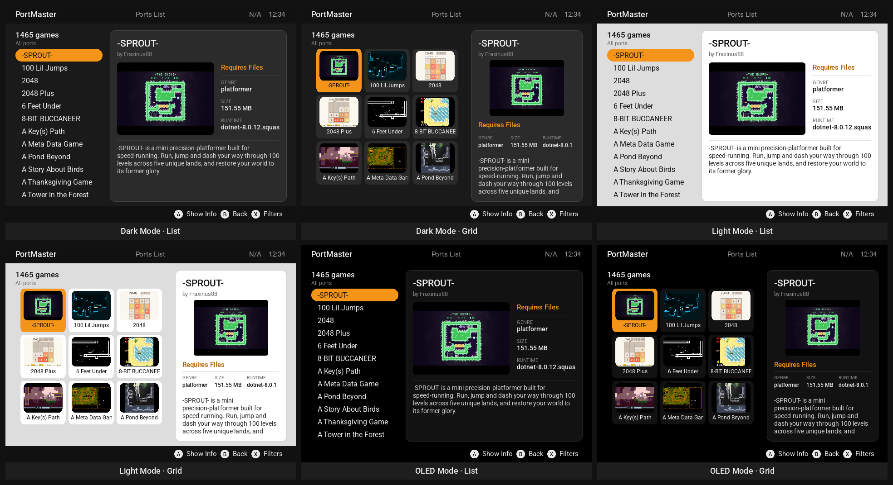

**New to themes?** Start with the step-by-step guide, [Creating a theme](https://github.com/PortsMaster/PortMaster-Themes/blob/main/CREATING_A_THEME.md), in the PortMaster-Themes repository. It builds a theme from nothing, and shows how to test it and share it. Come back here when you want the details.

The screenshots on this page are the default theme, **PortMaster New** (`PortMaster/pylibs/default_theme/`), rendered by the [theme server](#the-theme-server). `tools/theme_docs.py` makes them again when the theme changes.

## Contents

- [A theme's files](#a-themes-files)
- [theme.json at a glance](#themejson-at-a-glance)
- [How a region gets its keys](#how-a-region-gets-its-keys)
- [Capabilities: keys for some devices](#capabilities-keys-for-some-devices)
- [Areas: where a region goes](#areas-where-a-region-goes)
- [Colors](#colors)
- [Text](#text)
- [Images](#images)
- [Lists](#lists)
- [The button bar and special words](#the-button-bar-and-special-words)
- [Text templates](#text-templates)
- [Color schemes](#color-schemes)
- [Styles](#styles)
- [Elements](#elements)
- [Layouts: a list or a grid](#layouts-a-list-or-a-grid)
- [Translations](#translations)
- [Sounds and music](#sounds-and-music)
- [Animations](#animations)
- [The screens](#the-screens)
- [Region keys](#region-keys)
- [Tags](#tags)
- [The theme server](#the-theme-server)
- [Older PortMasters](#older-portmasters)

## A theme's files

A theme is a folder:

```
my_theme/
├── theme.json          everything about the theme: this page
├── screenshot.png      its picture in PortMaster's theme list (or screenshot.jpg)
├── CREDITS.md          who made the fonts and images, and their licenses
├── LICENSE.*.txt       those licenses
├── MyFont.ttf          fonts and images, named in theme.json
└── images/panel.png    (subfolders are fine: "image": "images/panel.png")
```

- **Installed themes** live in `PortMaster/themes/<folder>/` on a device. PortMaster's theme list downloads them from the [PortMaster-Themes](https://github.com/PortsMaster/PortMaster-Themes) releases, as `<folder>.theme.zip` with the folder inside.
- **File names** in `theme.json` are found in the theme's folder first, then in PortMaster's own `pylibs/resources/` (DejaVu Sans and the Noto Sans CJK fonts are there, so every theme can use them without carrying a copy).
- **Fonts** need a license that lets them be shared: the theme repository checks every font is listed in `CREDITS.md` with its license.

## theme.json at a glance

```json
{
    "#info":      { "name": "My Theme", "creator": "Me", "description": "…", "version": 1,
                    "default-scheme": "Dark", "default-layout": "List" },
    "#base":      { "font": "DejaVuSans.ttf", "font-size": 20, "font-color": "text" },
    "#pallet":    { "text": "#ffffff", "accent": [ 244, 149, 25 ] },
    "#resources": { "buttons.png": { "atlas": { "_A": [ 0, 0, 180, 180 ] } } },
    "#schemes":   { "Dark": { "#pallet": { … } }, "Light": { "#pallet": { … } } },
    "#styles":    { "caption": { "font-size": 11, "font-color": "text_faint" } },
    "#elements":  { "left_pane": { "area": [ 0.0, 0.1, 0.4, 0.92 ] } },
    "#layouts":   { "List": {}, "Grid": {} },
    "#override":  { "_CHECKED": "[x]" },
    "#translations": { "de_DE": { "Ports List": "Portliste" } },

    "main_menu":  { "option_list": { "area": [ 0.1, 0.1, 0.9, 0.9 ] }, … },
    "ports_list": { … },
    …
}
```

The `#` sections are the theme's settings and shared pieces. Every other top-level key is a **section**: one PortMaster screen, holding the **regions** drawn on it. A region is a rectangle that can have a fill, an outline, an image, text, a list or a bar of buttons. [The screens](#the-screens) lists every section and the regions it needs.

| Key | What it is |
|---|---|
| `#info` | `name` and `creator` (both needed to publish), `description` (shown in the theme list), `version`, `default-scheme`, `default-layout` |
| `#base` | keys every region starts from |
| `#pallet` | named colors: [Colors](#colors) |
| `#resources` | images (and atlases of them) and sounds, loaded when the theme loads: [Images](#images) |
| `#schemes` | color schemes the player picks from: [Color schemes](#color-schemes) |
| `#styles` | named sets of keys that regions start from: [Styles](#styles) |
| `#elements` | named regions any section can use, and areas other regions can sit in: [Elements](#elements) |
| `#layouts` | layouts the player picks from: [Layouts](#layouts-a-list-or-a-grid) |
| `#override` | text for the special words (`_A`, `_CHECKED` …): [The button bar](#the-button-bar-and-special-words) |
| `#translations` | the theme's own translations: [Translations](#translations) |
| `#animations` | frame counters for animated images: [Animations](#animations) |

JSON doesn't allow comments or a comma after the last item. The [theme server's editor](#the-theme-server) points out both, and much more, as you type.

## How a region gets its keys

A region's keys are merged from several places, each one over the last:

1. the theme's `#base` (after the color scheme's changes to it)
2. the section's own `#base`, if it has one
3. the `#elements` entry it's made from (`"#element:panel"`), on top of that entry's `style`
4. its own `style`
5. its own keys

So a key in the region wins over its style, its style over its element, and so on down to `#base`. Keys with [capabilities](#capabilities-keys-for-some-devices) are resolved at every step: `"font-size[hires]": 24` is `font-size` on a device with `hires`, and isn't there at all on one without.

A section can be given again with capabilities, to change some of its regions on some devices. Its other regions stay as they are:

```json
    "ports_list": {
        "ports_list": { "area": [ 0.0, 0.1, 0.4, 0.92 ], "font-size": 14 },
        "port_desc":  { "area": [ 0.42, 0.5, 1.0, 0.92 ] }
    },
    "ports_list[square]": {
        "ports_list": { "area": [ 0.0, 0.1, 1.0, 0.5 ] }
    }
```

A region can be given again the same way (`"ports_list[hires]": { … }`, after `"ports_list"`), which changes only the keys it has.

## Capabilities: keys for some devices

Any key can end in `[capabilities]`, and then counts only on devices that have them. When the same key is there more than once, **the last one that matches wins**, so put the general value first and the special cases after it:

```json
    "#base": {
        "font-scale": "auto",
        "font-scale[1280x720]": 1.5,
        "font-scale[hires,square]": 1.8
    }
```

- `,` means *and*: `[hires,square]` needs both.
- `|` means *or*: `[ja_JP|zh_CN|ko_KR]` needs one of them.
- `!` means *not*: `[!hires]`.

| Capability | When |
|---|---|
| `640x480`, `1280x720` … | the screen's size, width first |
| `4:3`, `16:9`, `3:2`, `1:1`, `16:10` … | the screen's shape (a 16:10 screen also has `16:9`) |
| `hires` | 960 wide or more, or 720 tall or more |
| `lowres` | narrower than 640 or shorter than 480 |
| `wide` | 3:2 or wider (16:9, 16:10, 5:3 …) |
| `square` | square or nearly: neither side more than 1.25 times the other (1:1, 1240x1080, 4:3 isn't) |
| `en_US`, `de_DE`, `ja_JP` … | the language PortMaster is in |
| `layout_<name>` | the [layout](#layouts-a-list-or-a-grid) the player chose (`layout_grid`) |
| `font_scale_auto` | PortMaster understands `"font-scale": "auto"`: see [Older PortMasters](#older-portmasters) |
| `power` | anything faster than an RK3326 |
| `opengl`, `vulkan` | desktop OpenGL (not just GLES), Vulkan |
| `analog_0` … `analog_2`, `analog_triggers`, `touch`, `rumble` | the controls |
| `1gb`, `2gb`, `4gb` … | at least that much memory |
| `aarch64`, `armhf`, `x86_64` | what it runs |

A screen that's `hires` is neither `lowres` nor 640x480-sized, so `[!lowres,!hires]` is "about 640x480". The [theme server](#the-theme-server) draws any screen at any size, with the capabilities a device of that size has, so you can see what each one gets.

## Areas: where a region goes

`area` is `[ left, top, right, bottom ]`, the region's two corners, in its **parent**: the whole screen, or the region or element named in `parent`.

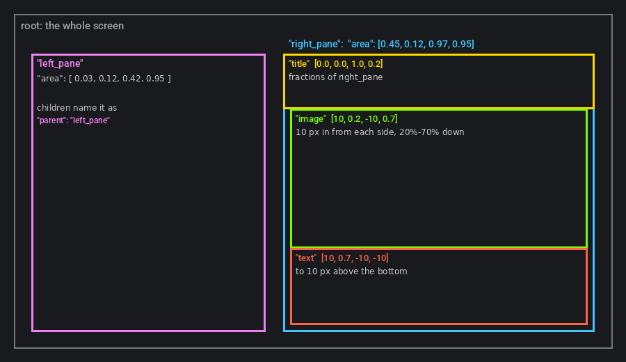

Each value is one of:

| Value | Means |
|---|---|
| `0.0` to `1.0`, with a decimal point | that fraction of the parent's width (left, right) or height (top, bottom) |
| a negative number | that many pixels in from the parent's right (or bottom) edge |
| a whole number for `left` or `top` | that many pixels in from the parent's left (or top) edge |
| a whole number for `right` or `bottom` | **a position on the screen, not in the parent**: use a fraction or a negative number instead |

`1.0` is the parent's whole width; `1` is one pixel. The theme server's editor keeps what you typed when it tidies the file, so a `1.0` stays a `1.0`.

```json
    "#elements": {
        "right_pane": { "area": [ 0.45, 0.12, 0.97, 0.95 ] }
    },
    "port_info": {
        "port_title": { "parent": "right_pane", "area": [ 0.0, 0.0, 1.0, 0.2 ] },
        "port_image": { "parent": "right_pane", "area": [ 10, 0.2, -10, 0.7 ] },
        "port_desc":  { "parent": "right_pane", "area": [ 10, 0.7, -10, -10 ] }
    }
```

A parent is an `#elements` entry, or a region earlier in the same section. Here are the default theme's ports list regions, numbered, as the theme server draws them with **Region boxes** on:

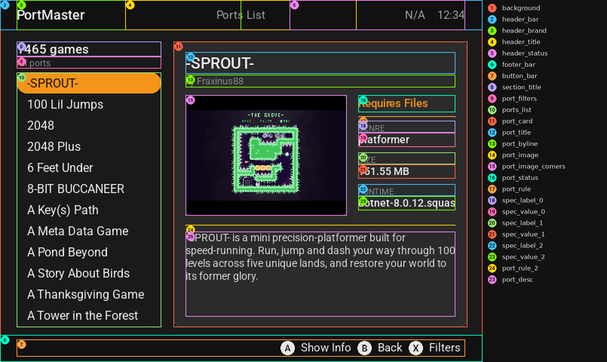

### Any screen size

PortMaster runs on screens no theme lists: portrait, ultrawide, nearly square, smaller than 640x480. A layout holds together on all of them when:

- **The screen is split into pieces, and each piece into smaller ones.** Give each a `parent` and fractions of it, so pieces next to each other meet where one ends (`[ 0.0, 0.11, 1.0, 0.52 ]`, then `[ 0.0, 0.52, 1.0, 1.0 ]`) instead of overlapping and being moved apart screen by screen. Then `area[…]` keys only move the splits (`"area[wide]"` on a pane), never single regions.
- **Pixels are only padding inside a region's own box.** A region at `[ 5, 65, -5, -45 ]` stays 65 pixels down when the text above it is twice the size.
- **Content ends above the button bar**, or sits beside it.
- **Text sizes follow the screen:** `"font-scale": "auto"` first in `#base` ([Text](#text)).

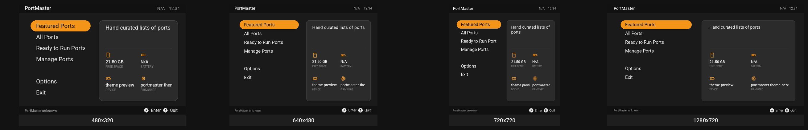

`serve.py --export OUT --check` renders every screen, then checks what each region drew where. It lists text or images of two regions on top of each other, content off the screen or outside its own region, and (as a warning) text drawn smaller or bigger than its font size, because its box doesn't fit it. It exits 1 if anything worse than a warning turns up. PortMaster's tests run it on the default theme at seven sizes.

## Colors

A color is any of:

- `[ r, g, b ]` or `[ r, g, b, a ]`, from 0 to 255 (`a` is opacity: 0 is see-through)
- `"#rrggbb"` or `"#rrggbbaa"`
- the name of a `#pallet` color

```json
    "#pallet": {
        "text":       "#e8eaed",
        "text_faint": [ 255, 255, 255, 140 ],
        "accent":     "#f7941d"
    },
    "#base": { "font-color": "text" }
```

Name every color in `#pallet` and use the names: then a [color scheme](#color-schemes) is just a different `#pallet`.

| Key | Colors |
|---|---|
| `fill` | the region's background |
| `outline`, `thickness` | a border around it, and how many pixels wide |
| `roundness` | rounds its corners by that many pixels |
| `font-color` | its text |
| `font-outline` | `[ color, thickness ]`: an outline around each letter |
| `progress-fill` | the done part of a progress bar (`message_window`'s `progress_bar`) |
| `select-fill`, `select-color` | a list's selected row: behind it, its text |
| `alt-fill` | every other row of a list, or the unselected tiles of a grid |
| `no-select-fill`, `no-select-color` | rows that can't be selected (headings) |
| `inactive-select-fill`, `inactive-select-color` | the selected row while the list isn't the one in use |
| `image-mod` | tints the region's image: each pixel times this color |

## Text

```json
    "port_title": {
        "area": [ 0.0, 0.0, 1.0, 0.2 ],
        "font": "Roboto-Medium.ttf",
        "font-size": 21,
        "font-color": "text",
        "align": "midleft",
        "text": "{port_info.title}"
    }
```

| Key | Default | |
|---|---|---|
| `font` | | a `.ttf` or `.otf` file |
| `font-size` | 30 | its size at 640x480 (before `font-scale`) |
| `font-scale` | 1.0 | multiplies `font-size`: a number, or `"auto"` |
| `font-color` | white | |
| `font-outline` | | `[ color, thickness ]` |
| `text` | | the text, with `{tags}`: [Text templates](#text-templates) |
| `align` | `topleft` | `topleft`, `midtop`, `topright`, `midleft`, `center`, `midright`, `bottomleft`, `midbottom`, `bottomright` (`topcenter` and `bottomcenter` are the same as `midtop` and `midbottom`) |
| `border`, `border-x`, `border-y` | 0 | space between the region's edge and its text: all round, left and right, top and bottom |
| `text-wrap` | false | break long text into lines |
| `text-clip` | true | cut off text that doesn't fit. With `false`, text that doesn't fit is drawn smaller |
| `line-height` | 1.0 | the space each line takes, times the font's own line height |
| `line-height-scale` | 1.0 | multiplies `line-height` (one key in `#base` for a language) |
| `line-space` | 0 | extra pixels between wrapped lines |
| `font-override` | | a font that wins over the region's own `font` (per language, in `#base`) |

### Sizes that follow the screen

`"font-scale": "auto"` gives text the size it has at 640x480, times `min(width / 640, height / 480)`, so 1280x720 gets 1.5, 1920x1080 2.25 and 640x360 0.75. It never goes below 0.75, so text on small screens stays readable. `"auto*1.2"` makes that a fifth bigger. Put it first: the sizes you give for particular screens after it still win, and a screen you didn't list (a 1240x1080 one) gets a sensible size instead of 640x480's.

```json
    "#base": {
        "font-scale": "auto",
        "font-scale[1280x720]": 1.5
    }
```

### Text that doesn't fit

A line too long for its region is cut off (`text-clip`), or drawn smaller with `"text-clip": false`. `autoscroll` scrolls it instead, sideways for one line and up and down for wrapped text:

| Key | Default | |
|---|---|---|
| `autoscroll` | | `"slide"` scrolls to the end, waits, and starts again; `"marquee"` scrolls there and back |
| `scroll-speed` | 30 | milliseconds between each step |
| `scroll-delay-start`, `scroll-delay-end` | 1000 | milliseconds to wait before it starts, and at the end |
| `scroll-direction` | `vertical` for wrapped text, else `horizontal` | which way it scrolls |
| `scrollable` | false | the player scrolls wrapped text with up and down |
| `scroll-amount` | 1 | lines per press, for `scrollable` |

A list scrolls its selected row's text the same way.

### Chinese, Japanese and Korean

Fonts like Roboto have no Chinese, Japanese or Korean letters, so those languages need fonts of their own. PortMaster has Noto Sans for each: `NotoSansJP-Regular.ttf`, `NotoSansKR-Regular.ttf`, `NotoSansSC-Regular.ttf` (simplified Chinese), `NotoSansTC-Regular.ttf` and `NotoSansHK-Regular.ttf`. `font-override` in `#base`, per language, is the font every region uses in that language, whatever font it names. Those fonts are taller, so `line-height-scale` makes the lines a little closer:

```json
    "#base": {
        "font": "Roboto-Regular.ttf",
        "font-override[ja_JP]": "NotoSansJP-Regular.ttf",
        "font-override[ko_KR]": "NotoSansKR-Regular.ttf",
        "font-override[zh_CN]": "NotoSansSC-Regular.ttf",
        "font-override[zh_TW]": "NotoSansTC-Regular.ttf",
        "font-override[zh_HK]": "NotoSansHK-Regular.ttf",
        "line-height-scale[ja_JP|zh_TW|zh_CN|zh_HK|ko_KR]": 0.8
    }
```

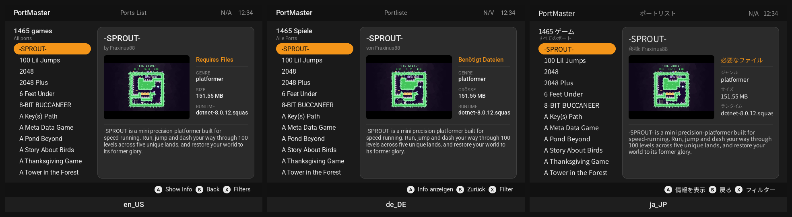

German and the other European languages have longer words than English: leave room, or let the text scroll.

## Images

```json
    "background": { "area": [ 0.0, 0.0, 1.0, 1.0 ], "image": "background.png", "image-mode": "stretch" },
    "logo":       { "area": [ 0.05, 0.02, 0.3, 0.1 ], "image": "logo.png", "image-align": "midleft" },
    "screenshot": { "area": [ 0.5, 0.2, 0.95, 0.6 ], "image": "{port_info.image}" }
```

| Key | Default | |
|---|---|---|
| `image` | | a file, a `#resources` name, a `{tag}` (the port's screenshot), or `qr:` and text |
| `image-mode` | `fit` | `fit` (whole image, its shape kept), `fit-horizontal`, `fit-vertical`, `stretch` (fills the region), `repeat` (tiles it) |
| `image-align` | `center` | where a fitted image sits: the `align` values |
| `image-size` | | `[ width, height ]` in pixels |
| `image-mod` | | a color that tints it |
| `patch`, `pimage`, `patch-repeat` | | draws it as a 9-patch: below |
| `blend-mode` | | `blend` (the default for images with transparency), `add`, `mod`, `mul`, `none` |

PNG, JPEG and SVG all work. An SVG in `#resources` can be given a size to be drawn at: `"logo.svg": { "size": [ 400, 120 ] }`.

### #resources and atlases

Images in `#resources` are loaded with the theme. Give one a `name` to use it by, `image-mod` to tint it, or an `atlas` to cut it into named pieces, each `[ x, y, width, height ]`, with optional flips and a rotation after (`[ x, y, w, h, flip_x, flip_y, angle ]`):

```json
    "#resources": {
        "bg_dark.png": { "name": "BACKGROUND" },
        "icons.png": {
            "atlas": {
                "icon_storage": [   0, 0, 64, 64 ],
                "icon_battery": [  64, 0, 64, 64 ],
                "arrow_left":   [ 128, 0, 32, 64 ],
                "arrow_right":  [ 128, 0, 32, 64, 1 ]
            }
        }
    }
```

A color scheme can change `#resources` (its own `BACKGROUND`, say): see [Color schemes](#color-schemes). Sounds go in `#resources` too: [Sounds and music](#sounds-and-music).

### Which images stay loaded

- **The theme's own images** (its files and PortMaster's, by name: `#resources`, a region's `image` and `pointer`, animation frames) stay loaded until the theme does.
- **Port screenshots and QR codes** come from the ports, and there can be any number of them, so only the 30 most recently drawn are kept (more while a grid shows more). One a region still shows when it's dropped is loaded again for its next draw.

So a big animation (many large frames) costs memory the whole time the theme is in use: keep frames small. (PortMaster before 2026.11 could drop a theme image that wasn't in `#resources` while a region still used it, and crash: list every image a theme uses there if it's meant for older PortMasters too.)

### 9-patch images

A 9-patch image keeps its corners and edges sharp at any size: `patch` gives how many pixels at the left, top, right and bottom don't stretch. The corners are drawn as they are, the edges stretch one way, and the middle both ways. `pimage` is the image to draw that way, if the region's `image` is something else.

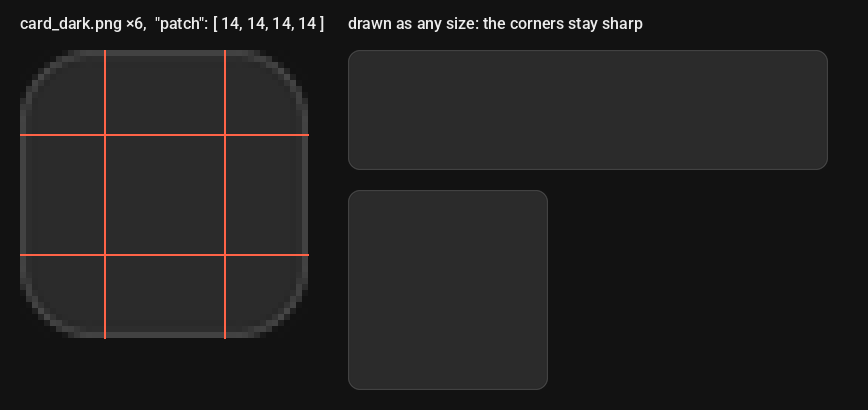

```json
    "port_card": {
        "area": [ 0.36, 0.11, 0.97, 0.9 ],
        "image": "card_dark.png",
        "patch": [ 14, 14, 14, 14 ],
        "patch[hires]": [ 20, 20, 20, 20 ]
    }
```

The default theme draws its rounded cards this way.

Stretching suits smooth edges and gradients, but not patterns or pixel art: a row of little pictures along an edge would be squashed or smeared. **`patch-repeat`** repeats the pieces at their own size instead, and cuts the last one off where the box ends:

| `patch-repeat` | |
|---|---|
| (none) | everything but the corners stretches |
| `"edges"` | the four edges repeat; the middle stretches (a pattern along the border, a plain or gradient middle) |
| `"all"` | the edges and the middle repeat (a texture all over) |

The region's text and list go inside the patch's edges, then inside its `border`: a picture with wide edges (a decorated strip) leaves less room for text, so give boxes with text a picture with narrow ones. A box smaller than the picture shows part of each edge, rather than all of it squeezed. Repeated pieces join up only if the picture's edges are drawn to: each edge's middle should end the way it starts. PortMaster before 2026.11 stretches them.

### QR codes

An `image` starting with `qr:` is a QR code of the text after it, which can use tags: `"image": "qr:{port_links.url}"`. It's redrawn when a tag's value changes, and an empty text shows nothing. The code is black on white with a white border, as phone cameras read best, and it's scaled up without smoothing so it stays sharp at any size. Give it a square area, or `"image-mode": "fit"` (the default), so it isn't stretched.

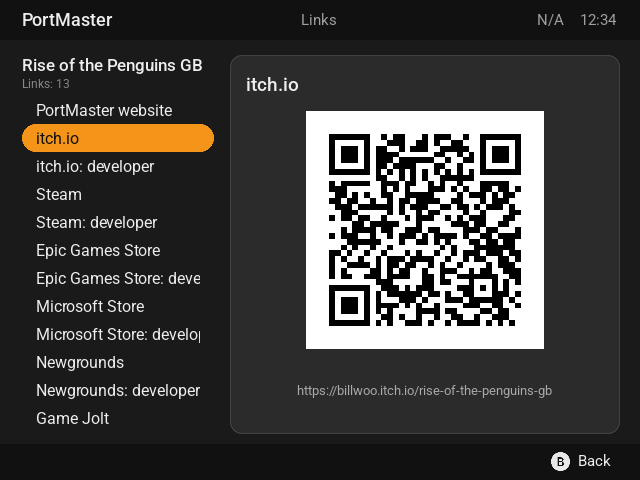

## Lists

A region with a list (`option_list`, `ports_list`, `filter_list` …) gets its rows from PortMaster. The theme decides how they look:

| Key | Default | |
|---|---|---|
| `item-size` | the font's line height | a row's height in pixels |
| `line-height` | 1.0 | a row's height, times the font's line height |
| `item-spacer` | 0 | pixels between rows |
| `select-fill`, `select-color` | | the selected row: behind it, its text |
| `alt-fill` | | every other row |
| `no-select-fill`, `no-select-color` | | rows that can't be selected |
| `inactive-select-fill`, `inactive-select-color` | | the selected row while another list is in use (the filters screen's ports list) |
| `list-header`, `list-header-add-blank` | | a heading row at the top, and a blank row after it |
| `list-section-add-blank` | false | a blank row before each heading in the list |
| `click-sound`, `click-sound-volume` | | a sound when the selection moves |

### The pointer

A pointer is an image drawn beside the selected row:

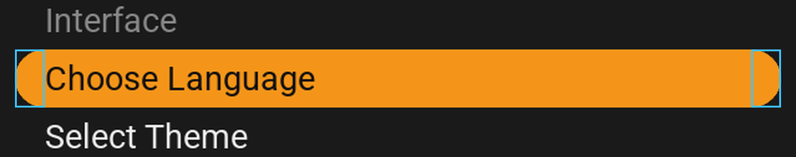

```json
    "option_list": {
        "select-fill": "accent",
        "pointer": "pill_cap.png",
        "pointer-fit": "row",
        "pointer-attach": "list",
        "pointer-align": [ "midleft", "midright" ],
        "pointer-mirror": true
    }
```

| Key | Default | |
|---|---|---|
| `pointer` | | the image (list it in `#resources` for older PortMasters) |
| `pointer-fit` | | `"row"`: the pointer is exactly a row tall, its width keeping the image's shape, at any font size and screen size |
| `pointer-attach` | `text` | `text`: beside the row's text; `list`: beside the row, and the list's side padding is the pointer's width |
| `pointer-align` | `[ "midright", "midleft" ]` | the point of the row it's attached to, and the point of the pointer that goes there |
| `pointer-mirror` | false | a second pointer at the other end, flipped (`pointer-mirror-x`, `pointer-mirror-y` choose the flips) |
| `pointer-flip-x`, `pointer-flip-y` | false | flip the pointer |
| `pointer-size` | the image's | `[ width, height ]` in pixels, without `pointer-fit` |
| `pointer-offset` | `[ 0, 0 ]` | moves it by that many pixels |

`pointer-size`, `pointer-offset` and `border-x` are pixels, which `font-scale` doesn't change, so a pointer sized for one screen is too big or too small for the rows on another: use `pointer-fit`.

### Grids

`list-columns` above 1 draws a list as a grid of tiles. Each tile shows the item's image (the port's screenshot) above its name. Only the ports lists have images; other lists draw tiles with just the name.

```json
    "ports_list": {
        "list-columns": 3,
        "list-columns[wide]": 4,
        "item-spacer": 8,
        "item-padding": 4,
        "alt-fill": "card",
        "select-fill": "accent",
        "roundness": 10,
        "autoscroll": "marquee"
    }
```

| Key | Default | |
|---|---|---|
| `list-columns` | 1 | columns, up to 6 |
| `item-size` | a 4:3 image and a line of text | a tile's height |
| `item-spacer` | 0 | pixels between tiles |
| `item-padding` | 4 | pixels between a tile's edge and its image and name |
| `alt-fill`, `select-fill` | | the tiles, and the selected one |
| `roundness` | 0 | rounds the tiles (and the images' corners, when the tile has a fill) |

Left and right move one tile, up and down one row, L1 and R1 one page. Keep a grid to about 30 tiles on screen at once: each tile's screenshot is loaded from the SD card. To offer a list and a grid in one theme, see [Layouts](#layouts-a-list-or-a-grid).

## The button bar and special words

A region tagged `button_bar` gets the buttons each screen offers ("A: Enter", "B: Back"). Its `bar` is a list of text and images, drawn in a row. A `null` splits it in two, the part before it on the left and the part after it on the right.

| Key | Default | |
|---|---|---|
| `bar` | | the list (PortMaster fills in the button bar's) |
| `bar-space` | 4 | pixels between the items |
| `bar-width` | | the smallest width an item takes |
| `button-sound`, `button-sound-alt` (and `-volume`) | | sounds for A, and for the other buttons |

A bar too long for its region is drawn smaller to fit it.

### Special words

Text can name buttons and checkboxes with special words, which a theme shows as text or as images:

| Word | | Word | |
|---|---|---|---|
| `_A`, `_B`, `_X`, `_Y` | face buttons | `_UP`, `_DOWN`, `_LEFT`, `_RIGHT` | the D-pad |
| `_START`, `_SELECT` | | `_L`, `_R` | shoulder buttons |
| `_CHECKED`, `_UNCHECKED` | a checkbox (the filters) | `_MORE` | more is below |

As images: `#resources` pieces with those names (the default theme cuts them out of `buttons.png` with an atlas). As text, in `#override`:

```json
    "#override": {
        "_A": "A:", "_B": "B:", "_X": "X:", "_Y": "Y:",
        "_CHECKED": "[x]", "_UNCHECKED": "[ ]"
    }
```

### Buttons of your own

A section's `#config` can give buttons other jobs on that screen. `port_info` has two: `"port_links"` (opens the port's links) and `"port_info_popup"` (opens the `port_info_popup` section, if the theme has one). A, B, X and Y are always PortMaster's.

```json
    "port_info": {
        "#config": { "buttons": { "UP": "port_info_popup", "R": "port_links" } },
        …
    }
```

## Text templates

`text`, `image` and `bar` items can use **tags** in braces, which PortMaster fills in and keeps up to date:

```json
    "text": "{port_info.title}"
    "text": "{system.cfw_name} {system.cfw_version}"
    "image": "menu_{menu.selected}.png"
```

A tag PortMaster doesn't know shows as it's written, braces and all. `{{` is a plain `{`. [Tags](#tags) lists them all.

**Conditions** show text only when a tag has a value, or a particular one:

```json
    "text": "{if:port_info.runtime}Runtime: {port_info.runtime}{else}No runtime needed{endif}"
```

| Condition | True when |
|---|---|
| `{if:tag}` | the tag isn't empty |
| `{if:!tag}` | the tag is empty |
| `{if:tag:text}` | the tag is exactly `text` |
| `{if:!tag:text}` | the tag isn't `text` |
| `{if:tag::other_tag}` | the two tags are the same |
| `{if:!tag::other_tag}` | they aren't |

Each `{if:…}` ends with `{endif}`, with an optional `{else}` between. Don't put one inside another.

Text without tags is translated as it is ([Translations](#translations)). Text with tags is translated before the tags are filled in.

## Color schemes

A theme can have color schemes, which the player picks in **Options › Select Color Scheme**. Each one changes the theme's `#pallet`, and can change its `#resources`, `#base` and `#styles` too:

```json
    "#info": { "default-scheme": "Dark Mode" },
    "#schemes": {
        "#base": {
            "#pallet":    { "accent": "#f7941d" },
            "#resources": { "buttons.png": { "atlas": { … } } }
        },
        "Dark Mode": {
            "#pallet":    { "background": "#1b1b1b", "text": "#e8eaed" },
            "#resources": { "card_dark.png": { "name": "card" } }
        },
        "Light Mode": {
            "#pallet":    { "background": "#f3f4f6", "text": "#1f2328" },
            "#resources": { "card_light.png": { "name": "card" } }
        }
    }
```

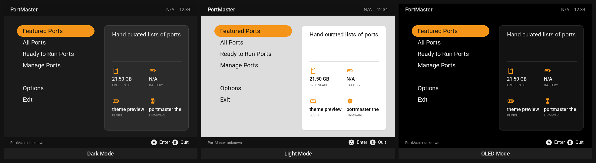

- `#schemes`' own `#base` is what every scheme starts from.
- A scheme's `#pallet`, `#resources` and `#base` take the place of the theme's. Its `#styles` change the theme's styles they name, and keep the rest.
- The chosen scheme is saved. A theme without it (another theme, or renamed in an update) gets its `default-scheme`, or its first.

## Styles

`#styles` gives a name to keys that many regions share, most often how their text looks. A region, an `#elements` entry or a `#base` names one with `"style"`, and starts from its keys:

```json
    "#styles": {
        "caption": { "font-size": 11, "font-color": "text_faint" },
        "label":   { "font": "Roboto-Medium.ttf", "font-size": 14, "font-color": "text" },
        "title":   { "style": "label", "font-size": 21 }
    },

    "port_info": {
        "spec_label_0": { "style": "caption", "area": [ 0.0, 0.0, 0.3, 0.5 ] },
        "spec_value_0": { "style": "label", "font-size": 16, "area": [ 0.0, 0.5, 0.3, 1.0 ] }
    }
```

- The region's own keys win: `spec_value_0` is a `label` at size 16.
- A style can name another one (`title` is a bigger `label`), and `"style": [ "label", "faint" ]` applies several in order, the later ones winning.
- Keys in a style can have capabilities like any other (`"font-size[hires]": 16`), and so can `style` (`"style[layout_grid]": "card"`).
- A color scheme can have `#styles` too.

The default theme has eight: `caption`, `byline`, `body`, `strong`, `value`, `section_title`, `title` and `status`.

## Elements

An `#elements` entry is a region any section can use, and an area other regions can sit in.

```json
    "#elements": {
        "header_bar": { "area": [ 0.0, 0.0, 1.0, 0.08 ], "fill": "chrome" },
        "left_pane":  { "area": [ 0.03, 0.11, 0.33, 0.9 ] },
        "side_list":  { "parent": "left_pane", "area": [ 0.0, 0.1, 1.0, 1.0 ], "select-fill": "accent" }
    },
    "ports_list": {
        "#element:header_bar": {},
        "#element:side_list:ports_list": { "font-size": 16 }
    },
    "filter_list": {
        "#element:header_bar": {},
        "#element:side_list:ports_list": {}
    }
```

- `"#element:header_bar"` draws the element as a region called `header_bar` in that section.
- `"#element:side_list:ports_list"` draws it as a region called `ports_list`: one look for the ports list on every screen that has one.
- The keys you give change the element's for that region only.
- Any region can name an element as its `parent`, whether the section draws the element or not.

## Layouts: a list or a grid

A theme can offer more than one layout, for example its ports as a list or as a grid, and the player picks one in **Options › Select Layout** (shown when the theme has more than one). List them in `#layouts`, and name the default in `#info`:

```json
    "#info":    { "default-layout": "List" },
    "#layouts": { "List": {}, "Grid": {} }
```

The chosen layout is a capability: `layout_` and its name in lower case, with anything but letters and digits as `_` ("Grid" is `layout_grid`, "Big Grid" `layout_big_grid`). So a key for it, after the theme's own, wins while that layout is chosen:

```json
    "ports_list": {
        "list-columns": 1,
        "list-columns[layout_grid]": 3,
        "list-columns[layout_grid,wide]": 4,
        "parent[layout_grid]": "grid_left"
    }
```

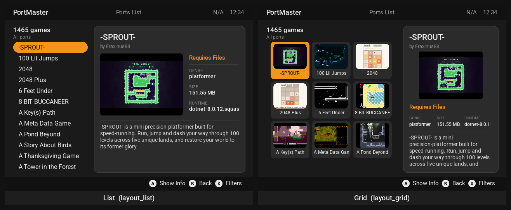

The default theme's Grid gives the ports list a wider pane (`grid_left`), and the port's card a narrower one with its screenshot above its details. The theme server has a **Layout** choice beside the color scheme, and `--layouts all` exports and checks every layout. The player's choice is saved; choosing another theme goes back to that theme's default layout, and a layout a theme doesn't have (renamed in an update, say) means its default.

## Translations

PortMaster is translated into many languages, and so is the text in themes: every `text` without tags (and the text around tags) is looked up in PortMaster's translations of themes' text, `PortMaster/pylibs/locales/<lang>.themes.json`. A theme's text is added to those when it's published in the theme repository.

A theme can also carry translations of its own, which win over PortMaster's:

```json
    "#translations": {
        "de_DE": { "Ports List": "Portliste", "Hand curated lists of ports": "Handverlesene Port-Listen" },
        "ja_JP": { "Ports List": "ポートリスト" }
    }
```

The theme server's **Translate** view is a translation editor for PortMaster's strings and every theme's text, with a preview of the screens each string is on.

## Sounds and music

Sounds are files in `#resources` (`.wav`, `.ogg`, `.mp3`, or `.mod` for music), optionally with a `name`:

```json
    "#resources": { "click.ogg": { "name": "click" }, "theme.mod": {} },
    "main_menu": {
        "background": { "area": [ 0.0, 0.0, 1.0, 1.0 ], "music": "theme.mod", "music-volume": 64 },
        "option_list": { …, "click-sound": "click" }
    }
```

| Key | |
|---|---|
| `music`, `music-volume` | music for the screen, on any of its regions (volume 0 to 128) |
| `click-sound`, `click-sound-volume` | a list's sound when the selection moves |
| `button-sound`, `button-sound-volume` | the `button_bar` region's sound for A |
| `button-sound-alt`, `button-sound-alt-volume` | its sound for the other buttons |

The player can turn music and sounds off in Options.

## Animations

`#animations` defines frame counters. Each one is a tag, `{animation.<name>}`, that counts `000`, `001`, … and can be used in an image name:

```json
    "#animations": {
        "spin": { "max-frames": 8, "update": 100, "loop": true }
    },
    "main_menu": {
        "spinner": { "area": [ 0.9, 0.02, 0.98, 0.08 ], "image": "spin_{animation.spin}.png" }
    }
```

| Option | Default | |
|---|---|---|
| `max-frames` | 1 | how many frames |
| `start` | 0 | the first frame |
| `skip-frames` | 1 | frames to count on by each time |
| `update` | 100 | milliseconds between frames (100 or more) |
| `loop` | true | start again after the last frame, or stop there |
| `reset-on-scene` | true | start again when the screen changes |

Each frame is an image that stays loaded with the theme: keep them few and small. For progress, the `system.progress_spinner_*` and `system.progress_perc_*` tags count for you.

## The screens

Every screen is a section of `theme.json`. A theme needs these seven, or PortMaster can't open those screens:

| Section | Screen | Needs a region called |
|---|---|---|
| `main_menu` | the main menu | `option_list` |
| `option_menu` | Options, and every list of choices in it | `option_list` |
| `ports_list` | All Ports, Ready to Run, Manage Ports | `ports_list` |
| `port_info` | a port's details, where it's installed | |
| `filter_list` | the filters and sorting | `filter_list` |
| `message_window` | downloads and installs, with their messages | `message_text` |
| `message_box` | a question or a warning | `message_text` |

These are made from the theme's other sections when it leaves them out:

| Section | Screen | Needs a region called | Without it |
|---|---|---|---|
| `themes_list` | the theme list | `themes_list` | `option_menu` |
| `runtime_list` | Runtime Manager | `runtime_list` | `option_menu` |
| `featured_ports_list` | Featured Ports | `option_list` | `option_menu` |
| `featured_ports` | a featured list's ports | `ports_list` | `ports_list` |
| `port_links` | a port's website and stores, as QR codes | `links_list` | `themes_list` |
| `theme_server` | Options › Theme Editor | | `themes_list` |
| `port_info_popup` | more about a port (a theme's own button opens it) | | not offered |

A region's name is how PortMaster finds it. `"tag"` gives a region another name to be found by, so `"background_list": { "tag": "option_list", … }` is the menu, and `"tag": null` hides a region from PortMaster. `on_screen_keyboard` (region `keyboard`) is a screen PortMaster doesn't use. The selection lists (`selection_list`, `selection_list_description`, `selection_list_images` and `selection_list_description_images`, the dialogs that autoinstall and ports' own scripts show), the disclaimer and the warnings for unsupported systems always look the same, whatever the theme.

Regions PortMaster looks for besides the required ones, on any screen:

- `button_bar`: the buttons for that screen (`bar`).
- `progress_bar` on `message_window`: filled to how far a download has got.
- Any region can show [tags](#tags): each screen's are listed below.

### main_menu

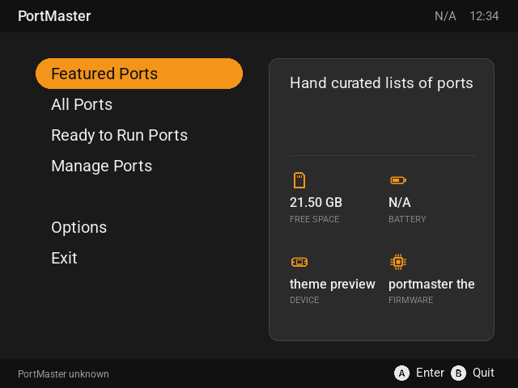 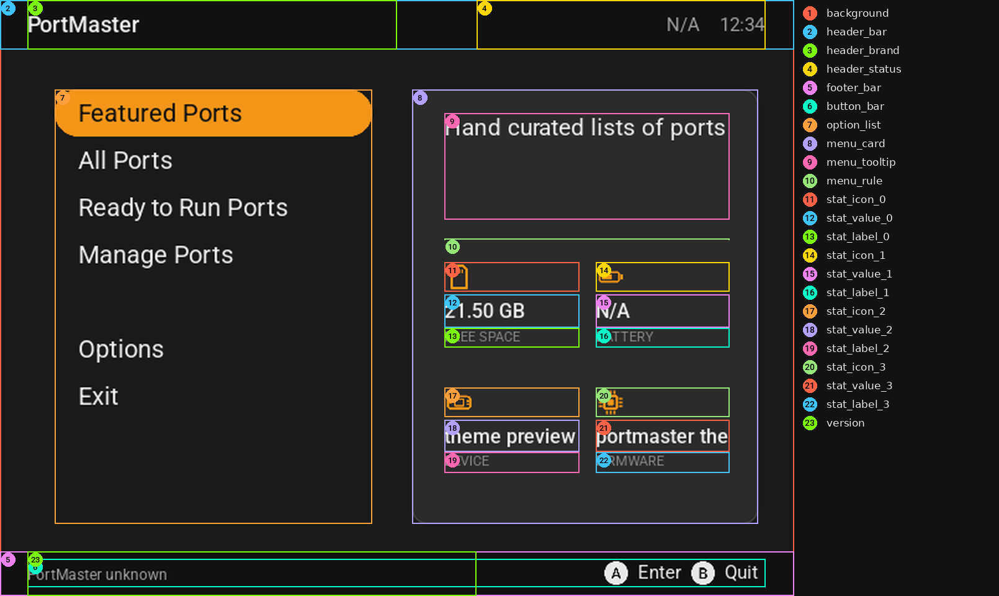

The first screen; backing out of it quits. `option_list`'s rows are Featured Ports, All Ports, Ready to Run Ports, Manage Ports, Options and Exit, each with a description in `{scene.tooltip}`, and the selected one's id in `{menu.selected}`: `featured-ports`, `install`, `install-rtr`, `uninstall`, `options` or `exit` (for `"image": "menu_{menu.selected}.png"`).

### option_menu

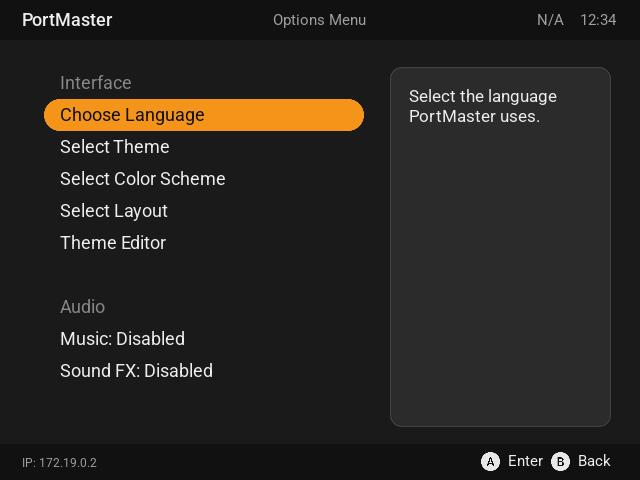 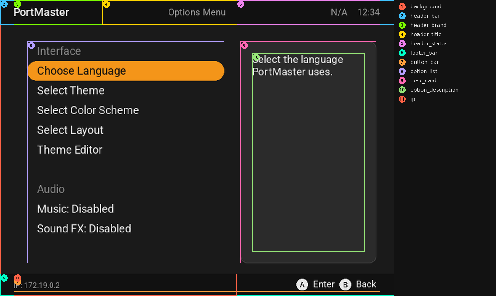

Options, and every list of choices it opens: languages, color schemes, layouts, sources, and so on. The selected option's description is in `{scene.tooltip}`, and its id in `{menu.selected}`.

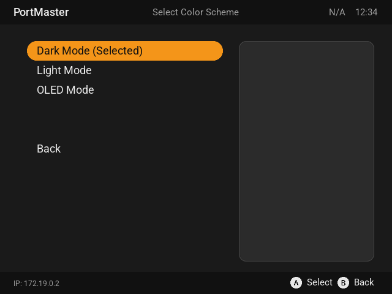 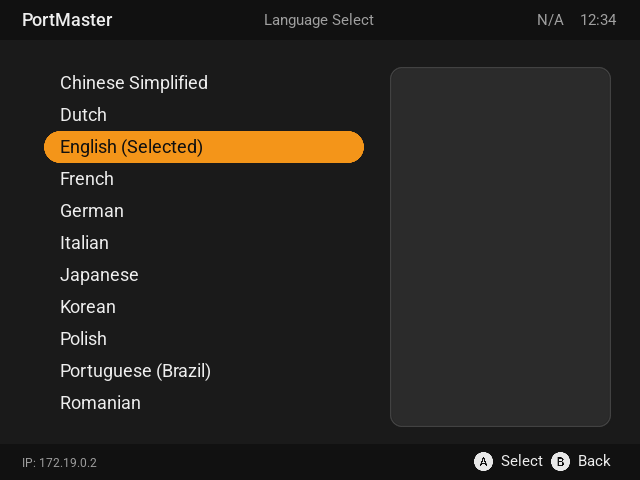

### ports_list

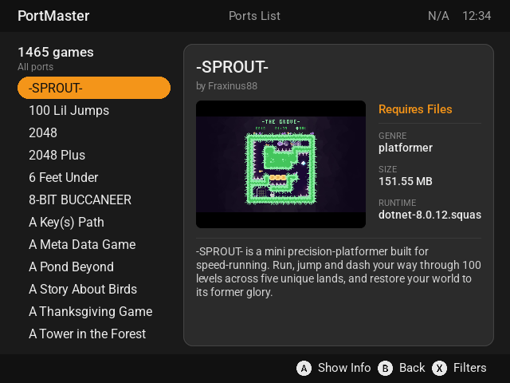

The ports: All Ports, Ready to Run Ports and Manage Ports. The selected port's details are in the `port_info.*` tags, and its screenshot in `{port_info.image}`. `{ports_list.total_ports}`, `{ports_list.filter_ports}` and `{ports_list.filters}` say how many there are and what's filtered. X opens the filters.

### port_info

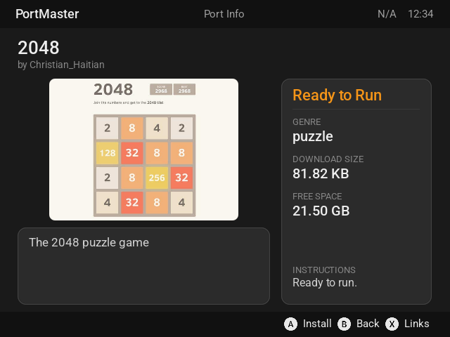 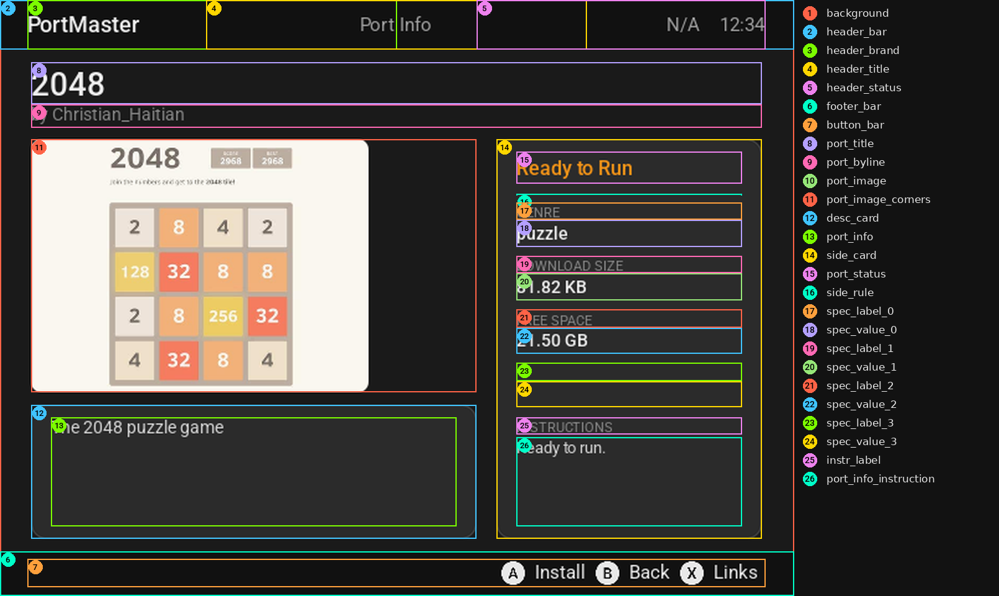

A port's details, with Install (or Uninstall) on A. The same `port_info.*` tags as the ports list. X opens the port's links when it has any (`{port_info.links}` isn't empty), so `{if:port_info.links}Links{endif}` shows only then.

### port_links

The port's page on the PortMaster website and the stores in its `port.json`, each as a QR code. The list is the region `links_list`; the selected link is in `{port_links.name}` ("Steam", "itch.io", "PortMaster website" …), `{port_links.url}` and `{port_links.kind}` (`website`, `store` or `developer`), and `{port_links.count}` is how many there are. Show the code with `"image": "qr:{port_links.url}"`. A theme without this section gets one made from its `themes_list`: its list, the QR code where the theme's screenshot goes and the address where its description goes.

### filter_list

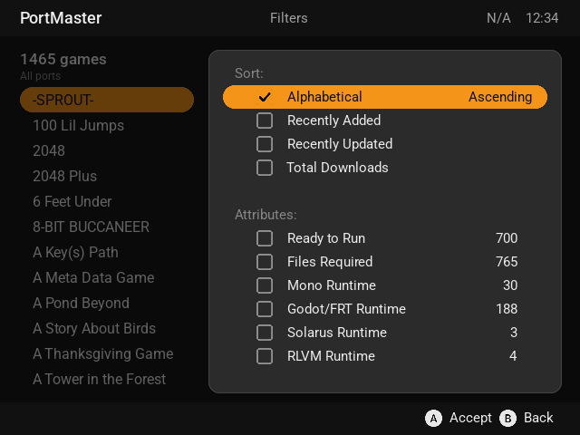

Sorting and filters, with `_CHECKED` and `_UNCHECKED` for each. The ports list stays on screen behind it, as the list not in use (`inactive-select-*`).

### featured_ports_list and featured_ports

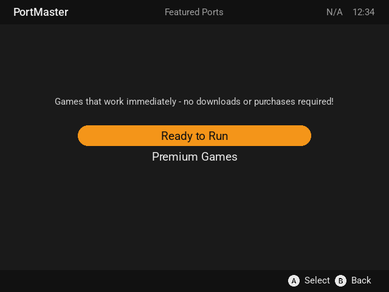 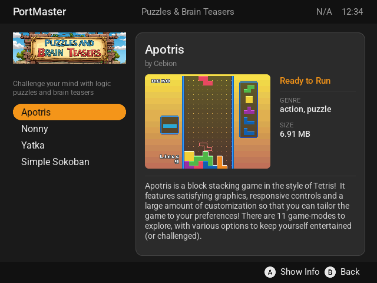

Featured Ports: the lists of ports (`option_list`, with `{featured_ports.name}`, `{featured_ports.description}` and `{featured_ports.image}`), then a list's ports, like the ports list.

### themes_list

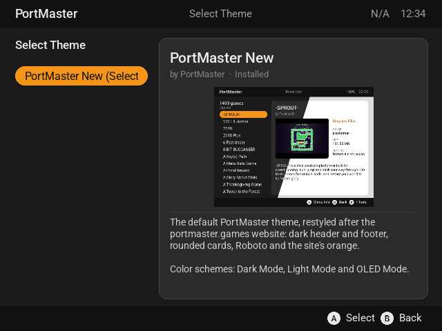

The themes, installed and to download: `{theme_info.name}`, `{theme_info.creator}`, `{theme_info.description}`, `{theme_info.status}` and the screenshot in `{theme_info.image}`.

### runtime_list

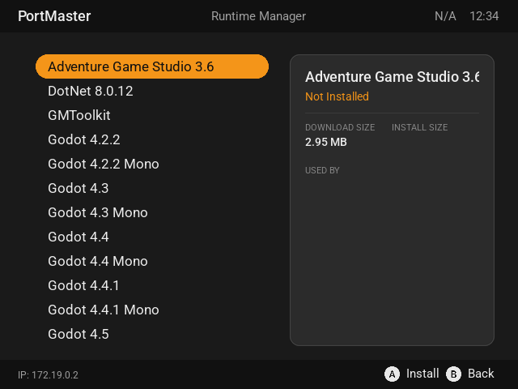

The runtimes (Mono, Godot, …), with `runtime_info.*`: its name, whether it's installed, which ports use it, and its sizes.

### message_window and message_box

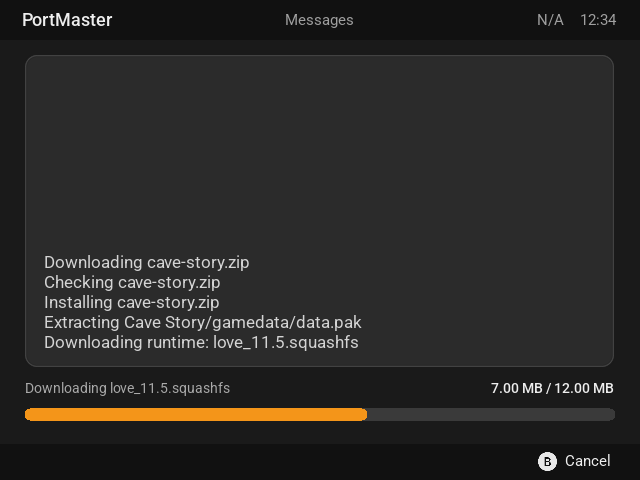 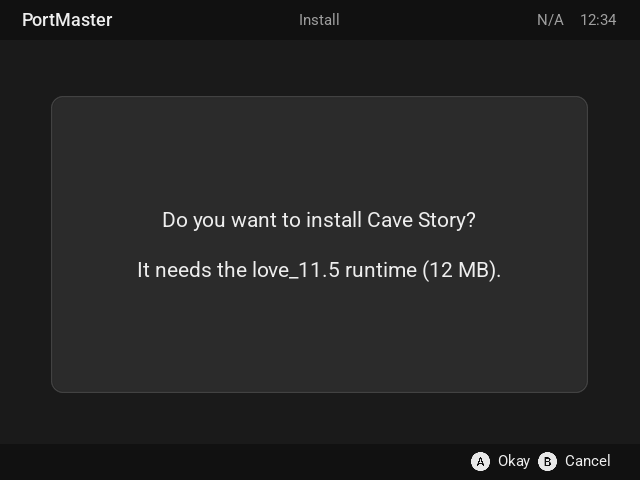

`message_window` shows what PortMaster is doing (`message_text` scrolls as messages arrive), with `{system.progress_text}`, `{system.progress_amount}` and a `progress_bar` while something downloads. `message_box` asks a question or says something went wrong: `message_text`, and the answers in the button bar.

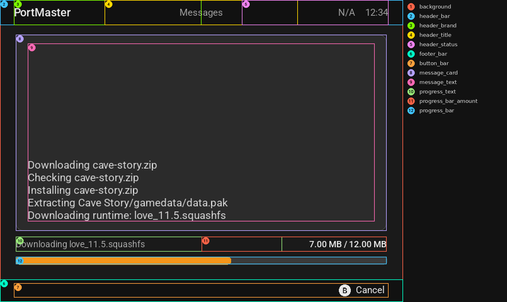

### theme_server

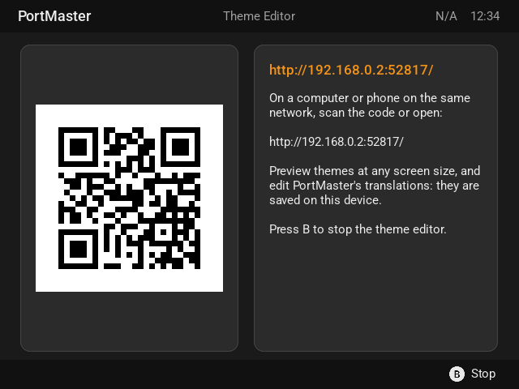

Options › Theme Editor: the address of the [theme server](#the-theme-server) on the device, in `{theme_server.url}` (empty until it's up), and what to do or what went wrong in `{theme_server.status}`. Show the address as a QR code with `"image": "qr:{theme_server.url}"`. A theme without this section gets one made from its `themes_list`.

## Region keys

Every key a region can have. Types: *color* ([Colors](#colors)), *area* ([Areas](#areas-where-a-region-goes)), *align* (`topleft` … `bottomright`), *file* (a file or `#resources` name).

| Key | Type | Default | |
|---|---|---|---|
| **Place** | | | |
| `area` | area | | where the region goes, in its parent |
| `parent` | name | `root` | the element or region its area is in |
| `z-index` | number | | drawing order: higher on top (otherwise the order in the section) |
| `visible` | true/false | true | `false` hides it |
| `tag` | name | its name | the name PortMaster finds it by; `null` for none |
| `style` | name or list | | the [style](#styles) it starts from |
| `comment` | text | | a note, ignored |
| **Box** | | | |
| `fill` | color | | its background |
| `outline` | color | | a border |
| `thickness` | number | 0 | the border's width |
| `roundness` | number | 0 | rounded corners, in pixels |
| `border`, `border-x`, `border-y` | number | 0 | space inside its edge: all round, the sides, top and bottom |
| `blend-mode` | text | | `blend`, `add`, `mod`, `mul`, `none` |
| `progress-fill` | color | | a progress bar's done part |
| **Image** | | | |
| `image` | file | | the image: a file, `#resources` name, `{tag}` or `qr:` text |
| `image-mode` | text | `fit` | `fit`, `fit-horizontal`, `fit-vertical`, `stretch`, `repeat` |
| `image-align` | align | `center` | where a fitted image sits |
| `image-size` | `[ w, h ]` | | its size in pixels |
| `image-mod` | color | | tints it |
| `patch` | `[ l, t, r, b ]` | | draws it as a 9-patch |
| `pimage` | file | | the 9-patch image, if not `image` |
| `patch-repeat` | text | | `edges` or `all`: repeat those pieces instead of stretching them |
| **Text** | | | |
| `text` | text | | the text, with `{tags}` |
| `font` | file | | |
| `font-override` | file | | wins over `font` (per language, in `#base`) |
| `font-size` | number | 30 | at 640x480 |
| `font-scale` | number or `"auto"` | 1.0 | multiplies the size |
| `font-color` | color | white | |
| `font-outline` | `[ color, n ]` | | an outline round the letters |
| `align` | align | `topleft` | |
| `text-wrap` | true/false | false | break into lines |
| `text-clip` | true/false | true | cut off what doesn't fit (`false`: draw it smaller) |
| `line-height` | number | 1.0 | a line's height, times the font's |
| `line-height-scale` | number | 1.0 | multiplies `line-height` |
| `line-space` | number | 0 | extra pixels between wrapped lines |
| `autoscroll` | text | | `slide` or `marquee` |
| `scroll-direction` | text | | `vertical` or `horizontal` (wrapped text scrolls up and down) |
| `scroll-speed` | number | 30 | milliseconds a step |
| `scroll-delay-start`, `scroll-delay-end` | number | 1000 | milliseconds before and after |
| `scrollable` | true/false | false | the player scrolls it with up and down |
| `scroll-amount` | number | 1 | lines a press |
| **List** | | | |
| `list` | list | | its rows (PortMaster fills in its own lists) |
| `options`, `info` | list | | the rows' ids and details (PortMaster's) |
| `item-size` | number | | a row's (or tile's) height in pixels |
| `item-spacer` | number | 0 | pixels between rows or tiles |
| `item-padding` | number | 4 | pixels inside a tile |
| `list-columns` | number | 1 | above 1: a grid |
| `select-color`, `select-fill` | color | | the selected row |
| `alt-fill` | color | | every other row; unselected tiles |
| `no-select-color`, `no-select-fill` | color | | rows that can't be selected |
| `inactive-select-color`, `inactive-select-fill` | color | | the selected row of a list not in use |
| `list-header` | text | | a heading row at the top |
| `list-header-add-blank` | true/false | false | a blank row after it |
| `list-section-add-blank` | true/false | false | a blank row before each heading |
| **Pointer** | | | |
| `pointer` | file | | an image beside the selected row |
| `pointer-fit` | text | | `row`: a row tall |
| `pointer-attach` | text | `text` | `text` or `list` |
| `pointer-align` | `[ align, align ]` | `[ "midright", "midleft" ]` | the row's point, the pointer's point |
| `pointer-size` | `[ w, h ]` | | in pixels |
| `pointer-offset` | `[ x, y ]` | `[ 0, 0 ]` | moves it |
| `pointer-flip-x`, `pointer-flip-y` | true/false | false | flips it |
| `pointer-mirror` | true/false | false | another at the other end |
| `pointer-mirror-x`, `pointer-mirror-y` | true/false | | flips the mirrored one |
| **Bar** | | | |
| `bar` | list | | text and images in a row; `null` splits it |
| `bar-space` | number | 4 | pixels between items |
| `bar-width` | number | | an item's smallest width |
| **Sound** | | | |
| `music`, `music-volume` | file, 0-128 | | the screen's music |
| `click-sound`, `click-sound-volume` | file, 0-128 | 128 | a list's moves |
| `button-sound`, `button-sound-volume` | file, 0-128 | 128 | A, on `button_bar` |
| `button-sound-alt`, `button-sound-alt-volume` | file, 0-128 | 128 | other buttons, on `button_bar` |

## Tags

Every tag PortMaster fills in. Sizes are text like "151.55 MB".

| Tag | |
|---|---|
| **Everywhere** | |
| `scene.title` | the screen's title ("Ports List") |
| `scene.tooltip` | the selected option's description, on menus |
| `menu.selected` | the selected option's id, on menus |
| `system.time_24hr`, `system.time_12hr` | "13:05", "01:05 PM" |
| `system.battery_level` | "85%", or "N/A" |
| `system.free_space`, `system.used_space`, `system.total_space` | of the SD card the ports are on |
| `system.device_name`, `system.cfw_name`, `system.cfw_version` | the device and its firmware |
| `system.ip_address` | the device's address on the network |
| `system.portmaster_version`, `system.harbourmaster_version` | |
| **Progress** (while something downloads or installs) | |
| `system.progress_text` | what it's doing |
| `system.progress_amount` | how far, as text ("12.3 MB / 40.0 MB") |
| `system.progress_perc` | how far, 0 to 100 |
| `system.progress_perc_5`, `system.progress_perc_10`, `system.progress_perc_20`, `system.progress_perc_25` | the same, in steps of 5, 10, 20 or 25 (for images: `"bar_{system.progress_perc_10}.png"`) |
| `system.progress_spinner_5`, `system.progress_spinner_10`, `system.progress_spinner_20`, `system.progress_spinner_25` | counts 5, 10 … 100 (in those steps) and round again, a step at each update: for a spinner image |
| `system.progress_perc_5_or_spinner`, `system.progress_perc_10_or_spinner`, `system.progress_perc_20_or_spinner`, `system.progress_perc_25_or_spinner` | the amount in steps when it's known, the spinner when it isn't |
| **The selected port** (ports lists, port info) | |
| `port_info.name` | its zip's name |
| `port_info.title` | its name ("Shovel Knight") |
| `port_info.image` | its screenshot |
| `port_info.description`, `port_info.instructions` | |
| `port_info.genres`, `port_info.porter` | |
| `port_info.ready_to_run` | "Ready to Run" or "Requires Files" |
| `port_info.download_size`, `port_info.install_size` | |
| `port_info.runtime`, `port_info.runtime_status` | the runtime it needs, and whether that's installed |
| `port_info.links` | how many links it has (empty if none) |
| **The ports lists** | |
| `ports_list.total_ports`, `ports_list.filter_ports` | all of them, and how many the filters show |
| `ports_list.filters` | the filters in use |
| `ports_list.position` | the selected port's place in the list |
| **Port links** | |
| `port_links.name`, `port_links.url`, `port_links.kind`, `port_links.count` | the selected link, and how many |
| **Featured ports** | |
| `featured_ports.name`, `featured_ports.description`, `featured_ports.image` | the selected list |
| **Themes** | |
| `theme_info.name`, `theme_info.creator`, `theme_info.description` | the selected theme |
| `theme_info.image`, `theme_info.status` | its screenshot, and installed or not |
| **Runtimes** | |
| `runtime_info.name` | "Godot/FRT 2.1.6" |
| `runtime_info.status` | "Installed" or "Not Installed" |
| `runtime_info.verified` | not filled in yet |
| `runtime_info.in_use`, `runtime_info.ports` | "Used" or "Not Used", and the ports that use it |
| `runtime_info.download_size`, `runtime_info.disk_size` | |
| **Dialogs** (always the default theme) | |
| `selection_list.title`, `selection_list.description`, `selection_list.image` | |
| **The theme editor** | |
| `theme_server.url`, `theme_server.status` | |
| **Animations** | |
| `animation.<name>` | the frame number of an `#animations` entry: `000`, `001` … |

## The theme server

The theme server draws every PortMaster screen with your theme, at any screen size, color scheme and language, and redraws when you save. It runs from a PortMaster-GUI checkout on Linux or macOS:

```bash
python3 -m venv .venv && .venv/bin/pip install -r requirements-dev.txt   # once
.venv/bin/python tools/theme_server/serve.py --themes ~/my-themes
```

Then open http://localhost:8090/. `--themes` is one theme folder (it has a `theme.json`) or a folder of them; the default theme is always there too.

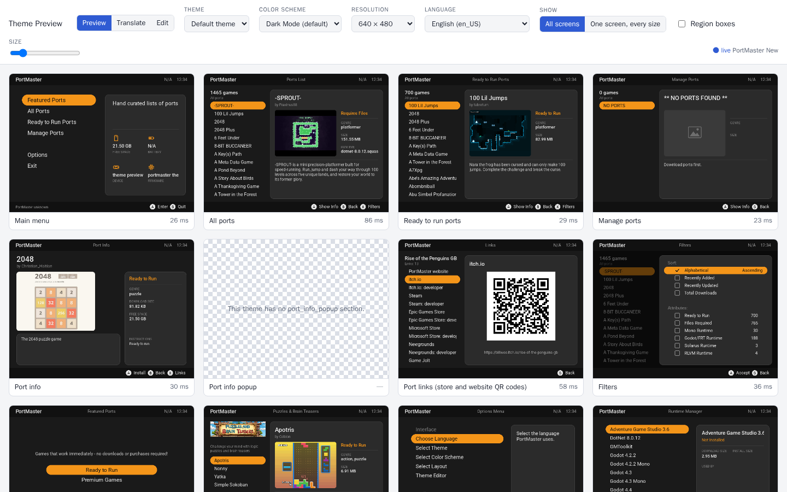

- **The screens:** every screen a theme draws, with the real ports list and screenshots (downloaded once into `~/.cache/portmaster-theme-server`; `--refresh-ports` gets the current ones), and the screens that always look the same.
- **Region boxes:** draws each region's area with its name. Click a screen to see it big; hover over or click a box to see the region's final keys, after `#base`, styles, elements and capabilities. **Save PNG** saves it.
- **One screen, every size:** one screen at every common resolution, to check your capability keys.
- **Color scheme and layout:** choose them at the top, as a player does in Options (Layout is there when the theme has more than one).
- A screen your theme has no section for says so. Errors PortMaster logged while drawing (a missing image, a bad color) are listed on it.

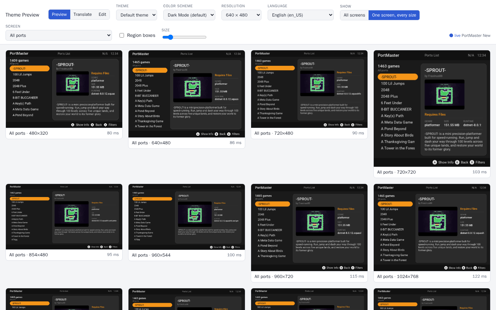

### Editing theme.json

**Edit** changes the theme's `theme.json` in the page, with one screen beside it that redraws a moment after you stop typing.

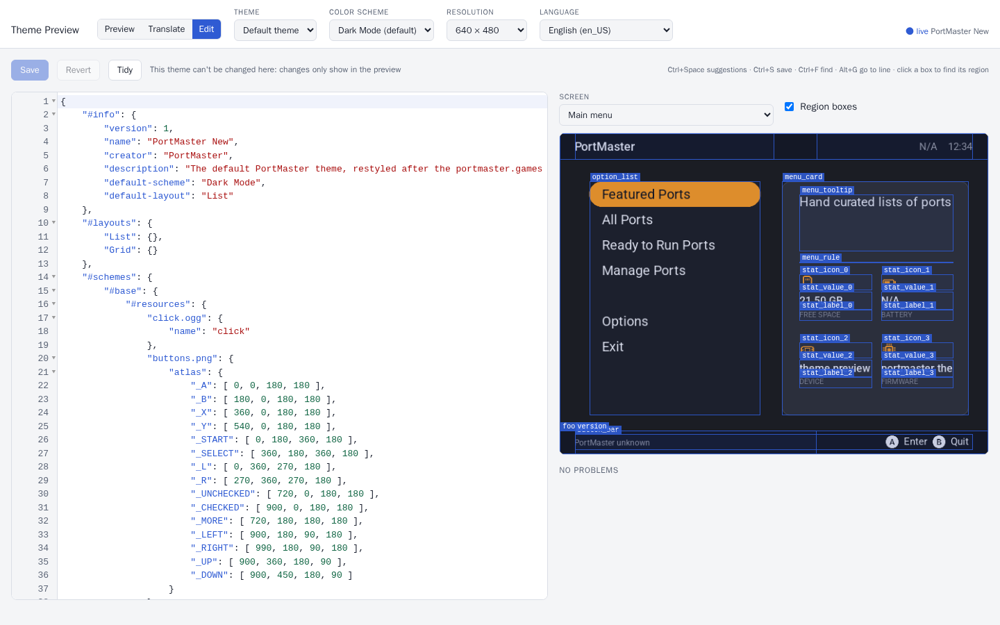

- **Region boxes:** click one to jump to that region in `theme.json`; put the cursor in a region to light up its box.
- **Suggestions** as you type (or Ctrl+Space): keys with their types, the values a key takes (alignments, your colors, styles, images, fonts, elements), `{tags}`, and `[capabilities]`. They come from PortMaster's own code, so they match what it accepts.
- **Checks:** JSON mistakes in plain words (a missing comma, a comma before `}`, comments), keys PortMaster doesn't know (with "did you mean"), values of the wrong type, colors, styles, images and fonts that don't exist, and the errors PortMaster logged while drawing.
- **Saving:** Ctrl/⌘+S. The previous version is kept as `theme.json.bak`, and you're asked before overwriting a file that changed on disk.
- **Tidy** gives the file even indents, keeping arrays of numbers on one line and numbers as you wrote them.
- **A new theme:** **Copy to a new theme…** copies any theme (the built-in one can't be changed) under a new name.

### Translating

**Translate** lists every string of PortMaster, and every theme's text, with a language's translation: filter by untranslated or problems, see the screens each string is on, and save into the language files.

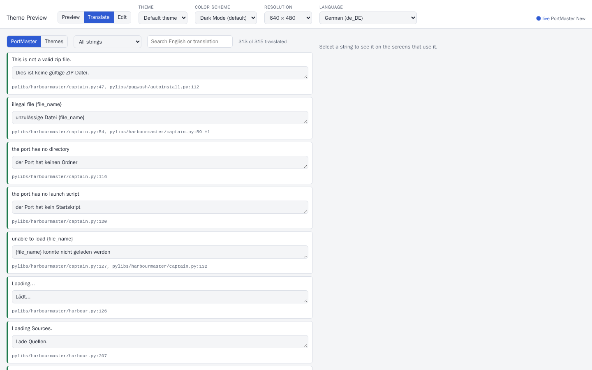

### On a device

**Options › Theme Editor** starts the same server on the device and shows its address as text and a QR code. Open it on a computer or phone on the same network: it previews the device's own themes and ports, and saves into `PortMaster/themes/`. Press B on the device to stop it. Anyone on the network can open it while it runs.

### Exporting and checking

```bash
.venv/bin/python tools/theme_server/serve.py --themes ~/my-themes --export out/ \
    --resolutions 640x480,1280x720,720x720 --schemes all --layouts all --langs en_US,de_DE --check
```

writes `out/<theme>/<resolution>/<scheme>/<layout>/<language>/<screen>.png` (and a `.json` beside each listing its regions), then [checks the layout](#any-screen-size). `--resolutions all` is every common screen size. Without `--layouts` it draws only the theme's default layout, and leaves out the `<layout>` folder.

## Older PortMasters

Themes in the theme list are downloaded by PortMasters of every age. What newer PortMasters understand, and what an older one does with it:

| Since | Feature | An older PortMaster |
|---|---|---|
| 2026.11 | `"font-scale": "auto"` | doesn't load the theme: give a number first, then `"font-scale[font_scale_auto]": "auto"` |
| 2026.11 | `font-override`, `line-height-scale` | ignores them: give `font[ja_JP]` & co in each region with its own font |
| 2026.11 | `#styles`, `style` | ignores them: the regions lose the style's keys |
| 2026.11 | `#layouts` | shows the theme's plain keys (the first layout, if those are its) |
| 2026.11 | theme images outside `#resources` stay loaded | can crash: list them all in `#resources` |
| 2026.11 | `"pointer-fit": "row"` | ignores it: give `pointer-size` and `border-x` too |
| 2026.11 | `patch-repeat` | stretches the 9-patch's pieces |
| 2026.11 | a 9-patch picture's `image-mod` (in `#resources`, or the region's) | draws it untinted |

The `font_scale_auto` capability exists only in PortMasters that understand `"auto"`, and keys with a capability a PortMaster doesn't have are skipped, so this loads everywhere and uses `auto` where it can:

```json
    "#base": {
        "font-scale": 1.0,
        "font-scale[font_scale_auto]": "auto",
        "font-scale[1280x720]": 1.5
    }
```
